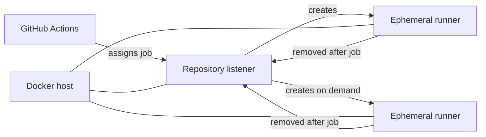

# How Aktion works

You do not need to learn Aktion's internal packages to operate it. The useful mental model has three parts: the Docker host, one listener for each repository, and temporary runners created for jobs.

## One repository, one listener

Every `enabled: true` repository gets an independent listener and a Runner Scale Set registered with GitHub. The same `scaleSetName` can be reused across repositories because each registration is repository-scoped.

The listener is a lightweight persistent container. Job runners do not need to be persistent: a runner is created after GitHub assigns work and removed when the job completes. With `minRunners: 0`, a repository can have zero runners while idle.

## Capacity is repository-scoped

`maxRunners` controls how many runners one repository may have at once. If two repositories both inherit `maxRunners: 3`, each may create up to three runners. Aktion does not combine them into one host-wide pool of three.

Host capacity therefore remains an administrative decision. Giving several repositories unlimited capacity can create many containers simultaneously.

## The host controls the runner image

A repository workflow controls what its job executes, but it cannot redefine the host-managed base runner image or Feature set through Aktion configuration. Aktion resolves the effective environment from `config.json`, builds a local image when necessary, and gives that image to the listener.

The default base is GitHub's lightweight actions runner image, not the GitHub-hosted Ubuntu VM. Put stable shared tooling in the [runner environment](../guides/runner-environment.md), while project-specific dependencies usually belong in the workflow.

## GitHub App authentication

The manager uses the configured GitHub App private key to authenticate the App and verify installations and repositories. Listeners connect to the Runner Scale Set service using the relevant installation identity.

The installation must have **Administration: Read and write** access to the repository. Aktion does not support substituting a PAT for the GitHub App.

## Docker executes the jobs

The listener uses Docker Engine to create ephemeral runner containers. The host must therefore provide a reachable Docker daemon and Linux container support.

!!! warning "Only attach trusted workflows to a self-hosted runner"
    A self-hosted runner executes arbitrary commands from repository workflows and can reach whatever network and runtime resources you give that runner. Do not casually route untrusted public pull requests or unfamiliar repositories to a host with sensitive access. Ephemeral runners reduce state left between jobs; they do not make untrusted code inherently safe.

If your goal is simply to run the first workflow, you can skip the rest of the conceptual material and follow the [quick start](../getting-started.md).
