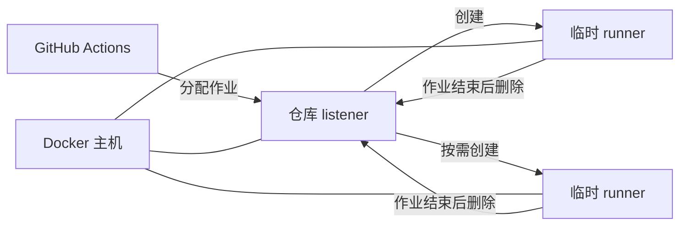

# Aktion 的工作方式

从使用者角度，Aktion 包含三个关键部分：Docker 主机、每个仓库对应的 listener，以及为作业临时创建的 runner。

## 每个仓库对应一个 listener

每个 `enabled: true` 的仓库都有独立的 listener，并在 GitHub 中注册自己的 Runner Scale Set。由于注册范围限定在仓库内，不同仓库可以使用相同的 `scaleSetName`。

listener 是持续运行的轻量容器，执行作业的 runner 则按需创建。GitHub 分配作业后，listener 创建 runner；作业结束后，runner 被删除。设置 `minRunners: 0` 时，仓库空闲期间可以保持零个 runner。

## 容量按仓库独立计算

`maxRunners` 决定单个仓库同时最多拥有多少个 runner。如果两个仓库都继承 `maxRunners: 3`，每个仓库都可以最多创建三个 runner。Aktion 不会把两者合并成全主机共享的三个 runner。

因此，Docker 主机的总容量需要单独规划。多个仓库都不设置 runner 上限时，作业集中到达可能同时创建大量容器。

## runner image 由主机配置

仓库工作流决定作业执行的命令，但不能通过 Aktion 配置重新定义由主机管理的基础 runner image 或 Feature 集。Aktion 根据 `config.json` 解析最终环境，必要时构建本地 image，再将该 image 交给 listener。

默认基础环境使用 GitHub 提供的轻量 actions runner image，而不是 GitHub-hosted Ubuntu VM。稳定、跨项目共用的工具可以加入 [runner 环境](../guides/runner-environment.md)；项目专用依赖通常应留在工作流中。

## GitHub App 认证

Aktion 主程序使用配置的 GitHub App 私钥进行认证，并检查 installation 与仓库。listener 则使用相应 installation 的身份连接 Runner Scale Set 服务。

该 installation 必须拥有仓库的 **Administration: Read and write** 权限。Aktion 不支持使用 PAT 代替 GitHub App。

## 作业在 Docker 容器中执行

listener 通过 Docker Engine 创建临时 runner 容器，因此主机必须提供可访问的 Docker daemon，并支持 Linux 容器。

!!! warning "仅将可信工作流接入自托管 runner"
    自托管 runner 会执行仓库工作流中的任意命令，并可以访问授予该 runner 的网络和运行环境。不要将不受信任的公开 pull request 或陌生仓库接入可访问敏感资源的主机。临时 runner 可以减少作业之间残留的状态，但不会自动隔离不可信代码带来的风险。

如需先完成第一次运行，可直接按照[快速开始](../getting-started.md)操作。
