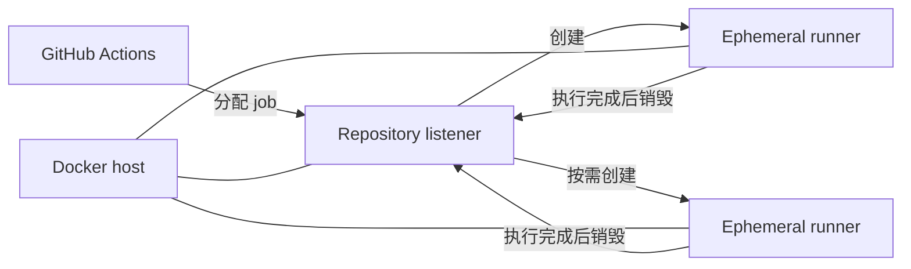

# Aktion 如何工作

理解 Aktion 不需要知道它的内部 package。对使用者来说，关键只有三个对象：Docker host、每个 repository 的 listener，以及为 job 临时创建的 runner。

## 一个 repository，一个 listener

每个 `enabled: true` 的 repository 都有独立 listener，并在 GitHub 侧注册自己的 Runner Scale Set。相同的 `scaleSetName` 可以被多个 repository 使用，因为它们的注册范围不同。

listener 是常驻的轻量 container。真正执行 workflow 的 runner 不需要常驻：当 GitHub 分配 job 时创建，完成后销毁。设置 `minRunners: 0` 时，没有工作负载就可以缩到零个 runner。

## 容量是 repository 级的

`maxRunners` 限制一个 repository 同时可以创建多少 runner。假设两个 repository 都继承 `maxRunners: 3`，那么每个都可以最多运行 3 个 runner；Aktion 不会把两者合并成一个“全主机 3 个”的池。

这也意味着主机容量需要由你自己规划。把多个 repository 都设成 unlimited 可能让 Docker 主机同时创建大量 container。

## Runner image 由 host 决定

目标 repository 的 workflow 决定 job 要执行什么，但不能通过 Aktion 配置改变 host 管理的基础 runner image 或 Feature 集。Aktion 根据 `config.json` 解析最终环境，需要时先构建本地 runner image，再把这个 image 交给 listener 使用。

默认基础镜像是官方轻量 runner image，不是 GitHub-hosted Ubuntu VM。需要哪些稳定的共享工具，应在 [Runner 环境](../guides/runner-environment.md) 中配置；只属于一个项目的依赖通常直接在 workflow 安装更合适。

## GitHub App 负责身份

Manager 使用你配置的 GitHub App private key 生成 App JWT，并验证 installation 与 repository。listener 随后使用对应 GitHub App installation 身份连接 Runner Scale Set 服务。

Aktion 要求 installation 对 repository 具有 **Administration: Read and write** 权限。它不支持用 PAT 代替 GitHub App。

## Docker 是执行边界

listener 通过 Docker Engine 创建 ephemeral runner container，所以 Aktion 运行目录所在主机必须能访问 Docker daemon，并能运行 Linux container。

!!! warning "只把可信的 workflow 放到自托管 runner"
    自托管 runner 会执行 repository workflow 中的任意命令，并能访问你授予该 runner 的网络与运行环境。不要把不受信任的公开 pull request 或陌生 repository 随意接入有敏感网络访问权限的主机。Aktion 的 ephemeral runner 能减少跨 job 残留，但不会把不可信代码自动变成安全代码。

如果你只想把第一个 workflow 跑起来，不必先读完这一页；直接从[快速开始](../getting-started.md)进入即可。
